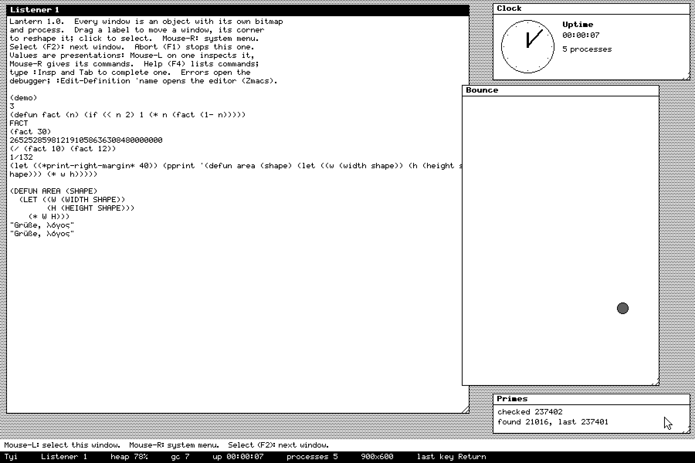
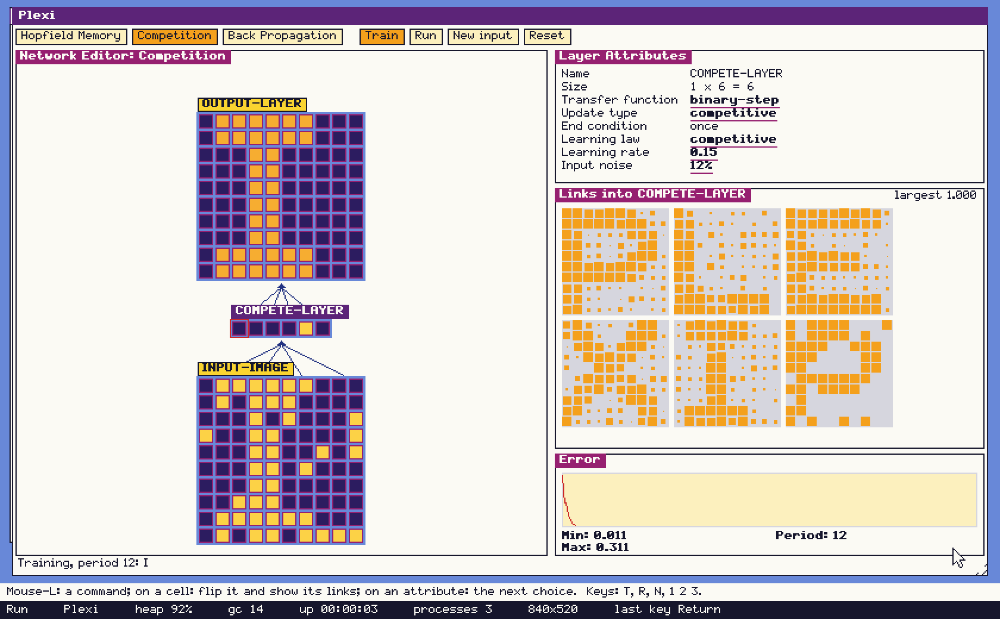

# Lantern

A Lisp Machine of your own, in a browser tab.


Lantern is a small Lisp environment in the spirit of the MIT CADR and the
Symbolics Lisp Machines. A C kernel, compiled to WebAssembly, gives it
tagged memory, a copying garbage collector, a bytecode VM and a screen.
Everything above that is written in Lisp and can be read and changed while
it runs: the compiler (which compiles itself at boot), the window system,
the Listeners, the Zmacs editor, the Inspector, the debugger with restarts,
and presentations that keep printed output connected to its objects.

The original LM-2 brochure highlights its remarkably high capacity for
the early 1980s: https://www.bitsavers.org/pdf/symbolics/brochures/LM-2.pdf.

Our own interpretation in Latern:



The language is most of Common Lisp: packages, CLOS with multiple dispatch,
conditions and restarts, `loop`, `format` and the pretty printer, bignums,
ratios and floats, arrays and bit vectors, Unicode strings, pathnames and
byte streams.

## Try it

```
make            # build the browser version into build/web/
make serve      # http://localhost:8742/, with world/*.lisp served to the editor
```

Or open `build/web/lisp.html`: the whole machine in one file, which works
straight from disk or from any plain web host. A saved world comes back
when you reload the page.

Some keys to start with:

| Key/Mouse | Description |
|-----------|-------------|
| Mouse-R | the system menu: new Listeners, the editor, Peek, the demos |
| F1 | Abort: stop what the selected window is doing |
| F2 | Select: the next window |
| F4 | Help: the Listener's commands |
| `(demo)` | the clock, the bouncing ball and the prime finder |
| `(ed 'name)` | Zmacs, at the definition of `name` |

Run it directly in the browser: [https://feyerabend.github.io/lantern/lisp.html](https://feyerabend.github.io/lantern/lisp.html).


## Plexi, in colour

In the late '80s and early '90s, neural networks saw a resurgence
as logic-based AI lost steam over unmet expectations. Still, they
demanded more speed and memory than most computers could offer.

In 1989 Symbolics sold Plexi, "an extensible, graphics-based development
environment for constructing neural networks", for the 3600 and the XL400:
https://www.bitsavers.org/pdf/symbolics/brochures/Plexi_1989.pdf.
Lantern has one of its own. `build/web/plexi.html` is the same machine with
a colour screen, and it starts in the Plexi editor. In the black-and-white
machine, `(plexi)` or "Plexi neural networks" in the system menu opens the
editor, and "Colour screen" turns the colour on.



The editor draws the network as layers of cells joined by bundles of links,
with the input at the bottom. Activations show as coloured cells, as on the
brochure's cover. Link weights show as a Hinton diagram, and the error (or a
Hopfield memory's energy) as a strip chart. A click on an input cell flips
it. A click on an attribute (transfer function, update type, learning law,
rate, noise) moves it to the next choice. There are three networks from the
period:

| Network | Description |
|---------|-------------|
| Hopfield Memory | 100 cells, each linked to all the others, store the letters P, L, E, X and I and recall them from noisy copies, one cell at a time (Hopfield, 1982). The letters overlap too much for Hebb's rule, so it uses the projection rule (Personnaz, Guyon and Dreyfus, 1986). Switch the learning law to Hebbian and press Train to watch E fail. |
| Competition | The brochure's own example: INPUT-IMAGE, COMPETE-LAYER, OUTPUT-LAYER. The competing cells learn the letters from noisy images without a teacher (Kohonen, with DeSieno's conscience, 1988), and the output layer is taught what each one should produce (counter-propagation, Hecht-Nielsen, 1987). |
| Back Propagation | The 8-3-8 encoder (Rumelhart, Hinton and Williams, 1986): three hidden cells must find a code for eight patterns. |

The networks are built in Lisp with `make-network`, `add-layer` and
`connect`, and `*plexi-network*` is the one on show. Plexi was extensible, and
so is this: `(deftransfer :name (x) ...)` adds a transfer function, and
`(deflearning-law :name (net bundle) ...)` a learning law. Both appear in the
attribute menus at once.

The colour screen keeps the 8-bit framebuffer. A colour map, `*color-map*`,
gives each of the 256 inks a colour, as the colour maps of the Lisp
Machines' colour screens did. `(color-ink r g b)` and `(ink :orange)` give a
program an ink, and each colour gets the free ink closest to its own
darkness. So a colour picture still reads on the black-and-white screen.

## Building

You need clang with the `wasm32` target, `wasm-ld` (from LLVM's lld), and
Python 3. No Emscripten, no libc in the kernel.

- **macOS:** `brew install llvm lld` (`wasm-ld` comes with lld). If your
  clang has no WebAssembly target, use LLVM's:
  `make CLANG=$(brew --prefix llvm)/bin/clang`.
- **Linux:** `apt install clang lld python3`.

```
make            # the browser version
make lisp       # a native REPL: ./build/lisp
make test       # the Lisp test suites (also under ASan/UBSan, a small heap and
                # GC stress), error reports, world images, and the screen tests
```

`make pdf` builds the manual from `docs/*.md`. It needs
[Tectonic](https://tectonic-typesetting.github.io) and the fonts the book
uses (Charter, Helvetica Neue, Menlo, as on macOS); the built PDF is in the
repository.

Run Plexi, in colour: [https://feyerabend.github.io/lantern/plexi.html](https://feyerabend.github.io/lantern/plexi.html).


## Reading

- [The manual](docs/A-Lisp-Machine-in-the-Browser.pdf) (PDF): the preface,
  the machine, and the history of the Lisp Machines.
- [docs/OVERVIEW.md](docs/OVERVIEW.md): what Lantern is, how it is built,
  and the language.
- [docs/LISP-MACHINES.md](docs/LISP-MACHINES.md): the original machines,
  and how each part of Lantern compares with them.
- [PLAN.md](PLAN.md): how it was built, milestone by milestone.

## The source

| Folder | Description |
|---|---|
| `kernel/` | the C kernel: memory, garbage collector, reader, printer, interpreter, VM, graphics, files |
| `world/` | the Lisp world, loaded in order at boot: compiler, objects, Common Lisp, windows, tools |
| `host/` | the browser side (`host.js`, `index.html`) and the native REPL |
| `fonts/` | the bitmap font, as text |
| `tests/` | the Lisp test suites and the screen tests |
| `tools/` | build helpers, the development file server, the screenshot tool |
| `docs/` | the manual and its sources |

## License

MIT; see [LICENSE](LICENSE).
